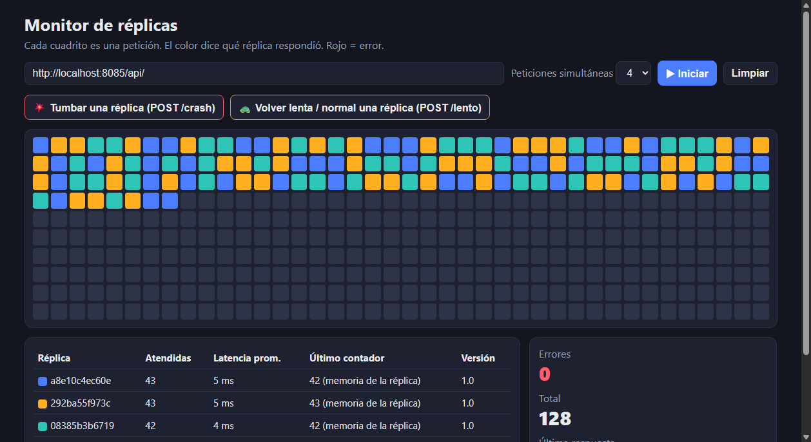
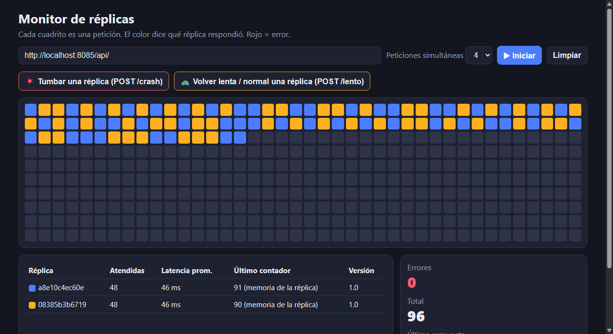
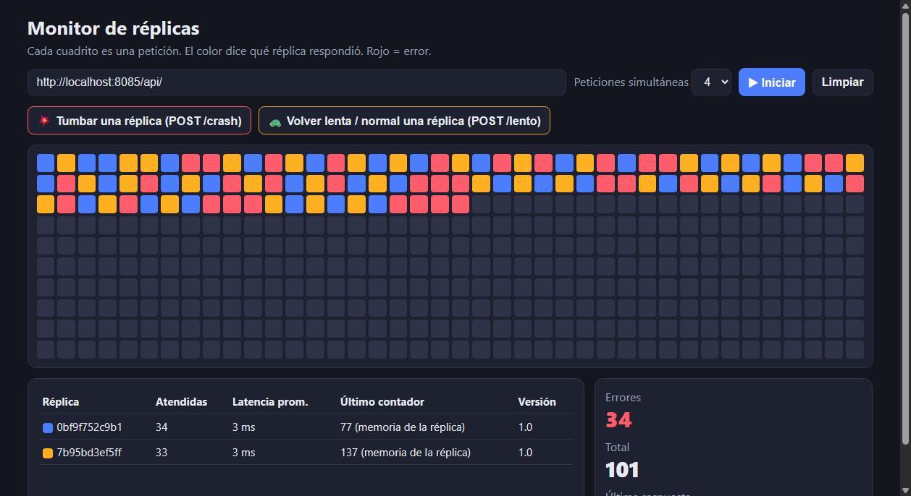
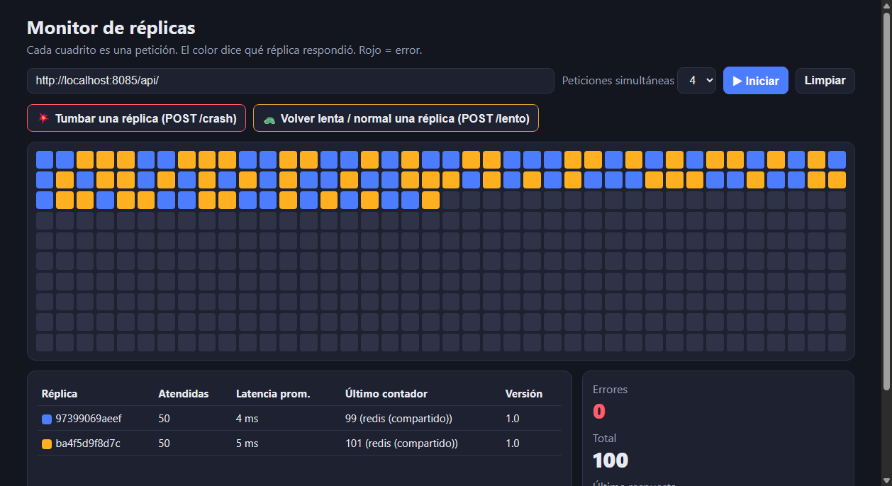
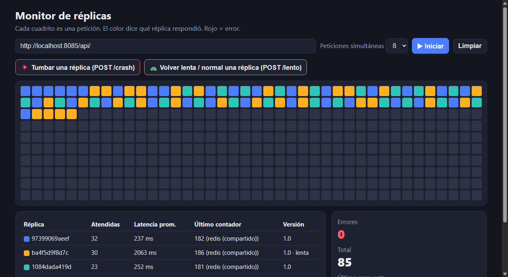
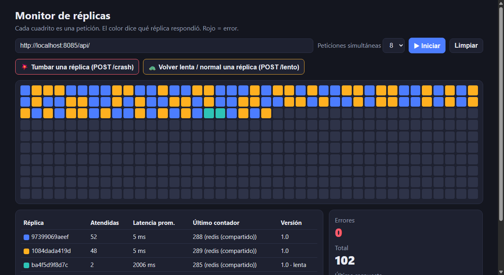

# Entrega · Laboratorio S12: Rompe la arquitectura (`docs/fallas-s12.md`)

> **Curso:** AIS86 Arquitectura de Software · UNAMBA  
> **Guía:** [GUIA_LAB_S12.html](../GUIA_LAB_S12.html)  
> **Entorno ejecutado:** Docker Engine `29.9.3`, Docker Compose, `nginx:1.30-alpine`, `redis:7.4-alpine`, `kind v0.33.0` (Kubernetes `v1.37.0`), `kubectl v1.36.1`.

---

## 1. Tabla de experimentos y evidencia

| Exp. | Qué rompimos | Qué vimos (evidencia) | Qué pieza lo resolvió y cómo | Integrante |
|---|---|---|---|---|
| **A2–A3** | Matamos el único contenedor (`solo`) con `POST /crash` (`os._exit(1)`), primero sin política de reinicio (A2) y luego con `--restart unless-stopped` (A3). | **A2:** `curl` devolvió `curl: (52) Empty reply from server` y el servicio quedó caído (punto único de falla).<br>**A3:** Antes del crash (`ac5afce29ba3`), el contador subió a `1 → 2 → 3`. Tras `POST /crash`, Docker lo reinició automáticamente en ~2 s (`Up 2 seconds`), pero el contador **volvió a empezar en `1`** (`memoria de la réplica`). | **Política de reinicio del motor de contenedores (`--restart unless-stopped`)** revivió el proceso caído, evitando intervención manual; sin embargo, demostró que reiniciar un contenedor **no preserva el estado en memoria** ni evita la interrupción momentánea. | *Roger Paniura Ramos* |
| **B1** | Despliegue de 3 réplicas detrás de NGINX con algoritmo Round Robin por defecto y memoria local. | **B1:** Peticiones equitativamente alternadas entre las 3 réplicas (33% c/u). En el monitor visual se observan **cuadritos de 3 colores alternándose**. Contador aislado en cada réplica.<br>*(Ver captura: [monitor_B1_round_robin.png](evidencias/monitor_B1_round_robin.png))* | **Balanceador L7 (`nginx`)**: Distribución uniforme de tráfico y desacoplamiento de clientes de las IPs directas de los contenedores. | *Roger Paniura Ramos* |
| **B2** | Con 3 réplicas detrás de `nginx`, matamos una réplica (`docker kill lab-fallas-api-2`) primero con `nginx.conf` (bueno) y luego con `nginx-defectuoso.conf`. | **B2(a) `nginx.conf`:** De 96 peticiones, **96 fueron `HTTP 200` y 0 errores**. La réplica caída desapareció del monitor sin un solo cuadrito rojo.<br>*(Ver captura: [monitor_B2a_failover_exitoso.png](evidencias/monitor_B2a_failover_exitoso.png))*<br>**B2(b) `nginx-defectuoso.conf`:** De 101 peticiones, **34 fallaron con cuadritos rojos** (33.7% error 502/504).<br>*(Ver captura: [monitor_B2b_nginx_defectuoso_rojos.png](evidencias/monitor_B2b_nginx_defectuoso_rojos.png))* | **Balanceador de carga Capa 7 (`nginx`)** mediante dos directivas clave ausentes en la config defectuosa: `max_fails=1 fail_timeout=10s` (health check pasivo que retira temporalmente la réplica caída) y `proxy_next_upstream error timeout` (reintenta la petición en otra réplica sana antes de responder al cliente). | *Roger Paniura Ramos* |
| **B3** | Observamos la inconsistencia de estado en memoria con 3 réplicas (cada réplica tenía su propio contador `1, 2, 3`) y luego externalizamos el estado configurando `REDIS_URL=redis://redis:6379/0`. | **Antes (B1):** 9 peticiones produjeron `1,1,1, 2,2,2, 3,3,3` (`memoria de la réplica`).<br>**Con Redis (B3):** 100 peticiones produjeron una secuencia continua **`1 → 2 → 3 → ... → 100`** con `contador_en: "redis (compartido)"` en el monitor visual.<br>*(Ver captura: [monitor_B3_redis_compartido.png](evidencias/monitor_B3_redis_compartido.png))* | **Estado compartido externo (`Redis`) + servicios *stateless***: sacar el estado fuera de los contenedores permite escalar horizontalmente y reemplazar réplicas sin que el usuario pierda o vea datos inconsistentes. | *Roger Paniura Ramos* |
| **B4** | Degradamos una réplica con `POST /api/lento` (latencia artificial de 2 s) y lanzamos ráfagas con concurrencia 8 usando *round robin* vs. `least_conn`. | **Round robin:** La réplica lenta recibió **30/85 peticiones (35.3 %)** con latencia promedio **2063 ms**, degradando la experiencia global.<br>*(Ver captura: [monitor_B4a_lenta_round_robin.png](evidencias/monitor_B4a_lenta_round_robin.png))*<br>**`least_conn`:** La réplica lenta cayó a solo **2/102 peticiones (1.9 %)**, mientras las dos réplicas rápidas atendieron el **98.1 %** del tráfico a 5 ms.<br>*(Ver captura: [monitor_B4b_lenta_least_conn.png](evidencias/monitor_B4b_lenta_least_conn.png))* | **Algoritmo de balanceo adaptativo (`least_conn` en `nginx`)**: en lugar de repartir a ciegas por turnos, envía cada nueva petición a la réplica con menos conexiones en curso, aislando automáticamente la réplica degradada. | *Roger Paniura Ramos* |
| **C3–C4** | En Kubernetes (`kind`, 3 nodos, `replicas: 3`): en **C3** eliminamos un pod (`kubectl delete pod api-78ccc9885b-lmrgt`) y en **C4** tumbamos el proceso dentro de un pod con `POST /crash`. | **C3:** Al borrar `lmrgt` (en `ais86-worker`), Kubernetes creó de inmediato el reemplazo `api-78ccc9885b-mpg2b` (IP `10.244.1.2` en `ais86-worker2`), `1/1 Running` en 4 s.<br>**C4:** `POST /crash` respondió `Empty reply from server`; el pod `api-78ccc9885b-mpg2b` mostró **`RESTARTS: 1`** y volvió a `1/1 Running`. El `Service` (capa 4) no reintenta peticiones en vuelo si ya fueron enrutadas al pod que cae. | **Orquestador (`Kubernetes Deployment` + `kubelet` + `Service`)**: el controlador de *Deployment* reconcilia el estado deseado (`replicas: 3`) recreando pods borrados; `kubelet` reinicia contenedores caídos; el `Service` descubre los pods dinámicamente por etiqueta `app: api` (sin IPs fijas). | *Roger Paniura Ramos* |
| **C6** | Con 5 réplicas repartidas entre `ais86-worker` y `ais86-worker2`, apagamos por completo una máquina (`docker stop ais86-worker`). | **t=15 s:** El control plane aún veía el nodo `Ready` y las pruebas mostraron errores (`3 OK / 5 Err`) hacia los 3 pods del nodo caído.<br>**t=30 s:** `ais86-worker` pasó a **`NotReady`**, sus 3 pods (`lld9h`, `vtxk4`, `xcvdf`) quedaron en `Terminating` y Kubernetes lanzó 3 pods nuevos (`9mff2`, `cn6jb`, `ntj2p`) en `ais86-worker2`.<br>**t=45 s:** Los **5 pods** estaban `1/1 Running` en `ais86-worker2`. | **Clúster multinodo + Orquestador (`tolerations: 15s`)**: al contar con múltiples nodos, el plano de control detectó la pérdida de `ais86-worker` y reprogramó la carga en el nodo sano `ais86-worker2`. La ventana de errores refleja el compromiso (*trade-off*) del tiempo de detección de fallos de nodo. | *Roger Paniura Ramos* |
| **C7** | Con 3 réplicas sanas, simulamos un despliegue defectuoso cuyo `/health` devuelve HTTP `500` (`kubectl set env deployment/api ROMPER_HEALTH=1`). | Tras 35 s, el pod nuevo (`api-6c657cfcdb-gnlgv`) quedó bloqueado en **`0/1 Running`** con **`RESTARTS: 2`** (fallando `readinessProbe` y `livenessProbe`), mientras los **3 pods anteriores** siguieron `1/1 Running`. Las pruebas de tráfico arrojaron **12 OK y 0 errores**. Luego `kubectl rollout undo deployment/api` limpió el pod roto. | **Despliegue progresivo (*Rolling Update*) + `readinessProbe` / `livenessProbe` de Kubernetes**: la estrategia por defecto (`maxSurge: 25%`, `maxUnavailable: 25%`) nunca retira los pods sanos hasta que el nuevo pase `readinessProbe`, impidiendo que una versión rota llegue a los usuarios. | *Roger Paniura Ramos* |

---

## 2. Pregunta final del equipo

> **En su sistema, ¿cuál de las fallas de hoy les dolería más y qué pieza de las 4 la previene?**

En un sistema en producción, las dos fallas más críticas son **(1) el despliegue de una versión defectuosa o la caída del servidor único (SPOF)** —que dejaría a todos los usuarios sin servicio al instante— y **(2) la pérdida de estado en memoria al reiniciar o escalar instancias**, que corrompería sesiones, carritos o transacciones activas. La pieza que previene la caída total del servicio es la combinación de **Orquestador + Clúster** (Kubernetes o AWS ECS Fargate con *health checks* y *rollback* automático), respaldada por un **Balanceador de Capa 7** (`nginx` / AWS ALB) que aísla réplicas caídas o lentas, y complementada por **almacenamiento de estado externo** (Redis / base de datos administrada) para que cualquier réplica sea completamente reemplazable sin pérdida de datos.

---

## 3. Anexo de evidencias reales (salidas de terminal ejecutadas)

> Si desean complementar esta entrega con capturas gráficas del monitor web (`http://localhost:8080` y `http://localhost:8090`), guárdenlas en `docs/evidencias/` y enlácenlas en la tabla superior.

### 3.1 Parte A · Contenedor único (`A1`, `A2`, `A3`)

```text
=== PARTE A1: Contenedor unico ===
{"replica":"0588074629e9","contador":1,"contador_en":"memoria de la réplica","version":"1.0","lento":false}
{"replica":"0588074629e9","contador":2,"contador_en":"memoria de la réplica","version":"1.0","lento":false}
{"replica":"0588074629e9","contador":3,"contador_en":"memoria de la réplica","version":"1.0","lento":false}

=== PARTE A2: Romper el contenedor (POST /crash) ===
curl: (52) Empty reply from server

=== PARTE A3: Politica de reinicio (--restart unless-stopped) ===
--- Antes del crash (3 peticiones) ---
{"replica":"ac5afce29ba3","contador":1,"contador_en":"memoria de la réplica","version":"1.0","lento":false}
{"replica":"ac5afce29ba3","contador":2,"contador_en":"memoria de la réplica","version":"1.0","lento":false}
{"replica":"ac5afce29ba3","contador":3,"contador_en":"memoria de la réplica","version":"1.0","lento":false}
--- Disparando POST /crash ---
curl: (52) Empty reply from server
--- docker ps --filter name=solo (tras reinicio automatico) ---
NAMES     IMAGE            STATUS         PORTS
solo      lab-fallas:1.0   Up 2 seconds   0.0.0.0:8000->8000/tcp, [::]:8000->8000/tcp
--- Despues del reinicio (el contador volvio a empezar en 1) ---
{"replica":"ac5afce29ba3","contador":1,"contador_en":"memoria de la réplica","version":"1.0","lento":false}
{"replica":"ac5afce29ba3","contador":2,"contador_en":"memoria de la réplica","version":"1.0","lento":false}
```

### 3.2 Parte B · Réplicas, `nginx` y Redis (`B1`, `B2`, `B3`, `B4`)

#### Capturas del Monitor Web (`http://localhost:8085`)

**1. Experimento B1 · Round Robin con 3 réplicas (Memoria Local):**  
Distribución homogénea entre las 3 réplicas (33% c/u). Cuadritos de 3 colores alternados, 0 errores.


**2. Experimento B2(a) · Failover exitoso con NGINX Configuración Buena:**  
Al matar `lab-fallas-api-2`, el balanceador redirige en milisegundos mediante `proxy_next_upstream`. Cero cuadritos rojos.


**3. Experimento B2(b) · NGINX Defectuoso (sin reintentos y `max_fails=0`):**  
Al matar la réplica, NGINX sigue enviándole tráfico a ciegas, produciendo un 33.7% de cuadritos rojos (errores HTTP 504 / 502).


**4. Experimento B3 · Estado Compartido con Redis (`REDIS_URL`):**  
Secuencia única global e incremental (1 a 100) compartida por todas las réplicas (`contador_en: redis (compartido)`).


**5. Experimento B4(a) · Réplica Lenta bajo Round Robin (Concurrencia 8):**  
La réplica degradada (2063 ms) sigue recibiendo el 35% del tráfico, bloqueando la capacidad del sistema.


**6. Experimento B4(b) · Réplica Lenta bajo Least Connections (`least_conn`):**  
El balanceador detecta la saturación y desvía el 98% del tráfico hacia las réplicas rápidas, protegiendo al usuario.


#### Registro de Terminal (Logs Ejecutados)

```text
=== PARTE B1: 3 replicas detras de nginx (round robin, memoria local) ===
{"replica":"cd0bcdde56d2","contador":1,"contador_en":"memoria de la réplica","version":"1.0","lento":false}
{"replica":"f30a821ca3ef","contador":1,"contador_en":"memoria de la réplica","version":"1.0","lento":false}
{"replica":"5c093add6b87","contador":1,"contador_en":"memoria de la réplica","version":"1.0","lento":false}
{"replica":"cd0bcdde56d2","contador":2,"contador_en":"memoria de la réplica","version":"1.0","lento":false}
{"replica":"f30a821ca3ef","contador":2,"contador_en":"memoria de la réplica","version":"1.0","lento":false}
{"replica":"5c093add6b87","contador":2,"contador_en":"memoria de la réplica","version":"1.0","lento":false}

=== PARTE B2(a): Matar lab-fallas-api-2 con nginx.conf (bueno) ===
B2(a) Resultado tras matar lab-fallas-api-2: OK=12, Errores=0
  Replica f30a821ca3ef: 6 peticiones
  Replica cd0bcdde56d2: 6 peticiones

=== PARTE B2(b): Matar lab-fallas-api-2 con nginx-defectuoso.conf ===
B2(b) Resultado con nginx-defectuoso.conf: OK=8, Errores=4
  HTTP 200: 8 peticiones
  HTTP 502: 1 peticiones
  HTTP 504: 3 peticiones

=== PARTE B3: Estado compartido en Redis (REDIS_URL=redis://redis:6379/0) ===
{"replica":"d32a5d752d48","contador":1,"contador_en":"redis (compartido)","version":"1.0","lento":false}
{"replica":"be5be1aef23f","contador":2,"contador_en":"redis (compartido)","version":"1.0","lento":false}
{"replica":"a0e4f5be3367","contador":3,"contador_en":"redis (compartido)","version":"1.0","lento":false}
{"replica":"d32a5d752d48","contador":4,"contador_en":"redis (compartido)","version":"1.0","lento":false}
{"replica":"be5be1aef23f","contador":5,"contador_en":"redis (compartido)","version":"1.0","lento":false}
{"replica":"a0e4f5be3367","contador":6,"contador_en":"redis (compartido)","version":"1.0","lento":false}

=== PARTE B4: Una replica lenta (d32a5d752d48) - 24 peticiones, concurrencia 8 ===
--- B4(a) ROUND ROBIN ---
Replica      Requests AvgMs Lento
-------      -------- ----- -----
d32a5d752d48        8  2004  True
a0e4f5be3367        8     2 False
be5be1aef23f        8   343 False

--- B4(b) LEAST_CONN ---
Replica      Requests AvgMs Lento
-------      -------- ----- -----
be5be1aef23f       12   142 False
a0e4f5be3367       11    91 False
d32a5d752d48        1  2003  True
```

### 3.3 Parte C · Kubernetes con `kind` de 3 nodos (`C1`–`C8`)

```text
=== C3: Borrar pod api-78ccc9885b-lmrgt ===
pod "api-78ccc9885b-lmrgt" deleted from default namespace
NAME                   READY   STATUS    RESTARTS   AGE   IP           NODE
api-78ccc9885b-mpg2b   1/1     Running   0          4s    10.244.1.2   ais86-worker2
api-78ccc9885b-vtxk4   1/1     Running   0          8s    10.244.2.2   ais86-worker
api-78ccc9885b-xcvdf   1/1     Running   0          8s    10.244.2.4   ais86-worker

=== C4: POST /crash -> Kubernetes reinicia el contenedor ===
POST /crash -> curl: (52) Empty reply from server
NAME                   READY   STATUS    RESTARTS     AGE   IP           NODE
api-78ccc9885b-mpg2b   1/1     Running   1 (6s ago)   10s   10.244.1.2   ais86-worker2
api-78ccc9885b-vtxk4   1/1     Running   0            14s   10.244.2.2   ais86-worker
api-78ccc9885b-xcvdf   1/1     Running   0            14s   10.244.2.4   ais86-worker

=== C5: Escalar a 5 replicas (descubrimiento automatico por el Service) ===
Replicas distintas atendiendo tras escalar a 5: 5
  api-78ccc9885b-89d9m: 7 peticiones
  api-78ccc9885b-lld9h: 8 peticiones
  api-78ccc9885b-mpg2b: 2 peticiones
  api-78ccc9885b-vtxk4: 4 peticiones
  api-78ccc9885b-xcvdf: 4 peticiones

=== C6: Caida de nodo (docker stop ais86-worker) ===
--- t=15s (probe 8 reqs: OK=3, Err=5) --- ais86-worker todavia figura Ready
--- t=30s (ais86-worker pasa a NotReady y se crean 3 pods nuevos en ais86-worker2) ---
--- t=45s (5 pods 1/1 Running en ais86-worker2; 3 pods viejos en Terminating en ais86-worker) ---
NAME                  STATUS     ROLES           AGE
ais86-control-plane   Ready      control-plane   2m8s
ais86-worker          NotReady   <none>          117s
ais86-worker2         Ready      <none>          118s

=== C7: Despliegue roto (ROMPER_HEALTH=1) ===
NAME                   READY   STATUS    RESTARTS        AGE     IP           NODE
api-6c657cfcdb-gnlgv   0/1     Running   2 (2s ago)      35s     10.244.2.2   ais86-worker
api-78ccc9885b-89d9m   1/1     Running   0               2m13s   10.244.1.3   ais86-worker2
api-78ccc9885b-9mff2   1/1     Running   0               72s     10.244.1.6   ais86-worker2
api-78ccc9885b-mpg2b   1/1     Running   1 (2m19s ago)   2m23s   10.244.1.2   ais86-worker2
Trafico durante despliegue roto: OK=12, Errores=0
deployment.apps/api rolled back
```

---

## 4. Recordatorio de reglas de entrega (GitHub / Pull Requests)

1. Cada integrante debe completar sus filas asignadas en la tabla (y agregar sus capturas si corresponde) subiéndolas en **su propio Pull Request**.
2. Otro integrante del equipo debe **revisar y aprobar el PR** antes de fusionarlo a `main`.
3. En la revisión en clase, cualquier integrante debe poder repetir en vivo cualquiera de los experimentos.
