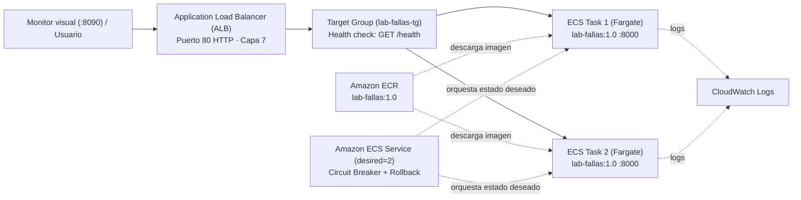

# Guía y Documentación · Laboratorio S12 en AWS (ECR + ECS Fargate + ALB)

> Basado en [GUIA_LAB_S12_AWS.html](../GUIA_LAB_S12_AWS.html) · AIS86 Arquitectura de Software · UNAMBA

Esta guía documenta la migración de la **misma imagen Docker (`lab-fallas:1.0`)** desde el entorno local (Docker Compose + `nginx` + `kind`) hacia servicios administrados en **AWS** (**ECR**, **ECS Fargate** y **ALB**), junto con los **3 Puntos de Control** y el protocolo obligatorio de limpieza para evitar consumo de créditos.

---

## 1. Equivalencia de arquitectura: Local vs. AWS

| En local (Sesión Lunes) | En AWS (Sesión Miércoles) | Rol arquitectónico |
|---|---|---|
| `docker build` + imagen local | **Amazon ECR** (*Elastic Container Registry*) | Almacena la imagen de contenedor para que la nube pueda descargarla |
| Sección `api` de `compose.yaml` | **Task Definition** (Definición de tarea) | Especifica imagen, CPU (0.25 vCPU), RAM (0.5 GB), puerto (`8000`), variables y logs en CloudWatch |
| `replicas: 3` / `Deployment` de Kubernetes | **ECS Service** con *Desired tasks = 2* | Mantiene el estado deseado y reemplaza automáticamente tareas caídas |
| `nginx` (`upstream`) | **ALB** (*Application Load Balancer*) + **Target Group** | Balanceo de carga en **Capa 7** (HTTP) y *health checks* activos sobre `/health` |
| Nodos de `kind` (`control-plane`, `worker`) | **AWS Fargate** (*serverless*) | Provee cómputo (CPU/RAM) sin administrar servidores EC2 |
| `kubectl rollout undo` (manual) | **Deployment Circuit Breaker** con *Rollback* | Detecta fallas de despliegue (umbral mínimo 3) y revierte automáticamente a la revisión sana |



---

## 2. Preparación previa (antes de desplegar)

1. **Cuenta AWS y región:** confirmar la región asignada a la cuenta (para Perú suele ser **US East (Ohio) — `us-east-2`**).
2. **Presupuesto de seguridad:** en *Billing and Cost Management → Budgets → Create budget*, configurar un *Monthly cost budget* de **US\$ 10** con correo de alerta.
3. **AWS CLI v2.32+:**
   ```powershell
   aws --version
   # Si no está instalado:
   winget install Amazon.AWSCLI
   ```
4. **Imagen local lista:**
   ```powershell
   docker build -t lab-fallas:1.0 ./app
   # En Mac Apple Silicon (M1-M4) usar arquitectura x86_64 para Fargate:
   # docker build --platform linux/amd64 -t lab-fallas:1.0 ./app
   ```

---

## 3. Parte A · Subir la imagen a Amazon ECR

```powershell
# A1. Iniciar sesión con credenciales temporales (hasta 12 h)
aws login
aws sts get-caller-identity

# A2. Variables y push a ECR (ajustar $REGION si no es Ohio)
$REGION = "us-east-2"
$CUENTA = (aws sts get-caller-identity --query Account --output text)
$REPO   = "$CUENTA.dkr.ecr.$REGION.amazonaws.com/lab-fallas"

aws ecr create-repository --repository-name lab-fallas --region $REGION
aws ecr get-login-password --region $REGION | docker login --username AWS --password-stdin "$CUENTA.dkr.ecr.$REGION.amazonaws.com"
docker tag lab-fallas:1.0 "${REPO}:1.0"
docker push "${REPO}:1.0"
```

> **Plan B (Docker Hub público):** si `aws login` falla con la cuenta, subir a Docker Hub y usar el URI `docker.io/<usuario>/lab-fallas:1.0` en la Task Definition de ECS.

---

## 4. Parte B · Despliegue en ECS Fargate detrás de un ALB

Configuración resumida en la consola `console.aws.amazon.com/ecs/v2`:

1. **Clúster (`B1`):** nombre `lab-fallas`, infraestructura **AWS Fargate (serverless)**.
2. **Task Definition (`B2`):**
   - Familia: `lab-fallas` | Launch type: `AWS Fargate` | OS/Arch: `Linux/X86_64`
   - Recursos mínimos: **0.25 vCPU** / **0.5 GB RAM**
   - Execution role: *Create new role* (`ecsTaskExecutionRole`)
   - Contenedor: nombre `api`, Image URI de ECR, puerto `8000` TCP/HTTP, CloudWatch Logs activado.
3. **Service + ALB (`B3`):**
   - Service name: `api` | Desired tasks: **2** | Launch type: **FARGATE**
   - Deployment failure detection: **Deployment circuit breaker** + **Rollback on failures** activados.
   - Networking: VPC por defecto, todas las subredes, **Public IP: ON** (evita costo de NAT Gateway para descargar la imagen).
   - Security Group `lab-fallas-sg`: entradas HTTP `80` (*Anywhere*) y Custom TCP `8000` (*Anywhere* en lab; en producción restringir `8000` solo al Security Group del ALB).
   - Load balancing: nuevo ALB `lab-fallas-alb` (listener HTTP `:80`), Target Group `lab-fallas-tg`, **Deregistration delay: `10` s**, **Health check path: `/health`**.
4. **Acelerar Health Checks (`B4`):**
   - En *EC2 → Target Groups → `lab-fallas-tg` → Health checks → Edit*:
     - `Interval`: **10 s** | `Healthy threshold`: **2** | `Unhealthy threshold`: **2** | `Timeout`: **5 s**
5. **Validar con el monitor (`B5`):**
   ```powershell
   curl.exe http://<DNS-del-ALB>/
   docker compose --profile monitor up -d monitor
   ```
   Abrir `http://localhost:8090`, ingresar `http://<DNS-del-ALB>/` y presionar **▶ Iniciar**.

---

## 5. Parte C · Experimentos en la nube y Puntos de Control

| Punto de Control | Experimento | Comportamiento esperado | Explicación arquitectónica | Evidencia requerida |
|---|---|---|---|---|
| **✅ PC 1** | **B5 · Servicio activo en ALB** | El monitor alterna **2 colores** (*round robin*) y `lab-fallas-tg` muestra 2 targets `healthy`. | El ALB (capa 7) balancea tráfico HTTP sobre las 2 tareas Fargate gestionadas por ECS. | Captura del monitor (2 colores) + Targets `healthy`. |
| **✅ PC 2 (a)** | **C1 · Matar una réplica (`POST /crash`)** | Un color desaparece; pueden aparecer **algunos rojos** breves. En 1–2 min aparece un color nuevo con contador en 0. | A diferencia de `nginx` (`proxy_next_upstream`), el ALB no reintenta una petición fallida; **ECS** detecta la tarea detenida y lanza un reemplazo para mantener `desired=2`. | Captura de ECS → *Events* mostrando el lanzamiento de la tarea de reemplazo. |
| **✅ PC 2 (b)** | **C2 · Réplica lenta (`POST /lento`) y cambio de algoritmo** | Con *Round robin*, la réplica lenta (~2000 ms) recibe ~50 % del tráfico. Al cambiar el Target Group a **Least outstanding requests**, recibe muchas menos peticiones. | Equivalente a `least_conn` en `nginx`: el ALB enruta hacia el target con menos peticiones HTTP en vuelo. | 2 capturas del monitor (antes y después del cambio de algoritmo) comparando % de peticiones. |
| **✅ PC 3** | **C3 · Desplegar versión rota (`ROMPER_HEALTH=1`)** | Las tareas nuevas fallan `/health` (HTTP 500) y el ALB las marca `unhealthy`. Al llegar a **3 fallas**, el despliegue pasa a `FAILED` y ECS ejecuta **rollback automático**. **0 rojos** en el monitor. | El *health check* actúa como compuerta de calidad: ECS no drena las tareas sanas antiguas hasta que las nuevas pasen `/health`, y el *Circuit Breaker* revierte automáticamente. | Captura de *Events* / *Deployments* con el rollback + monitor sin cuadros rojos. |

---

## 6. Costo estimado y limpieza obligatoria (Parte D)

El laboratorio completo (~2 horas) consume aproximadamente **US\$ 0.15** de los créditos gratuitos (`us-east-2`):
- ALB: ~US\$ 0.06
- 2 tareas Fargate (0.25 vCPU / 0.5 GB): ~US\$ 0.05
- IPv4 públicas (ALB + tareas): ~US\$ 0.04

> **⚠️ OBLIGATORIO al terminar:** dejar el ALB y las tareas encendidos un mes consume ~US\$ 50.
> 1. ECS → clúster `lab-fallas` → servicio `api` → **Delete service** (*Force delete*).
> 2. EC2 → Load Balancers → `lab-fallas-alb` → **Delete**.
> 3. EC2 → Target Groups → `lab-fallas-tg` → **Delete**.
> 4. ECS → Clusters → `lab-fallas` → **Delete cluster**.
> 5. Opcional: ECR → `lab-fallas` → **Delete**.
> 6. Local: `docker compose --profile monitor down`.
> 7. Verificar que no queden Load Balancers ni tareas ECS activas.
